# Analytics de CRM para PME

Estudo de funil, receita recorrente, retenção e segmentação para uma vaga de analista de dados pleno com foco em CRM de pequenas e médias empresas.

A empresa do caso é a **Nexora**, vendedora fictícia do software **Nexora Gestão** (financeiro, propostas e atendimento) para PME brasileiras. O recorte vai de janeiro de 2023 a outubro de 2026, com data de corte em 31/10/2026.

**A base é 100% fictícia.** Cada linha sai de [`data/generate.py`](data/generate.py) com a semente `42`. Não há extração de cliente, planilha interna, dado de bureau nem empresa real. Nomes, e-mails (`@exemplo-ficticio.test`) e telefones (DDD `00`) foram fabricados para deixar isso óbvio. Rodar o script de novo reconstrói os mesmos arquivos.

## Perguntas de negócio

1. Onde o funil perde volume, e qual canal converte de verdade?
2. Qual o CAC de campanha e em quantos meses de MRR a mídia se paga?
3. Como evoluem MRR, ARR de run-rate, NRR e GRR?
4. Quais coortes ainda estão ativas depois de 6, 12 e 18 meses?
5. Qual a taxa de cancelamento de logos e de receita, e por qual motivo o MRR sai?
6. Quais segmentos RFM concentram receita, e qual o LTV por porte?
7. Dá para ordenar, com o que se sabe hoje, quem cancela nos próximos 90 dias?

## Como rodar

Requer Python 3.12.

```bash
python -m venv .venv
source .venv/bin/activate
pip install -r requirements.txt
make generate    # opcional: os CSV e o DuckDB já estão no repositório
make analysis    # figuras e outputs/churn_model.json
make test
make dashboard   # http://localhost:8501  (porta $PORT, se existir)
```

O dashboard lê `data/warehouse/crm.duckdb`. O Power BI lê os CSV em `data/warehouse/star/`. O passo a passo das medidas está em [`docs/powerbi.md`](docs/powerbi.md). O dicionário está em [`docs/dicionario.md`](docs/dicionario.md).

## O que esta base mostra

Números da semente 42, arredondados na prosa. As consultas em `sql/` reproduzem o detalhe.

Em outubro de 2026 a Nexora tem **327 clientes ativos**, MRR de **R$ 425 mil** e ARR de run-rate de **R$ 5,1 milhões**. Desde janeiro de 2024 o NRR médio foi **98,3%** e o GRR médio **97,8%**. No mês fechado de outubro o NRR foi 99,4% e o GRR 98,7%. A expansão não cobre contração e cancelamento: **quem faz o MRR crescer é logo novo**, não a base que já estava.

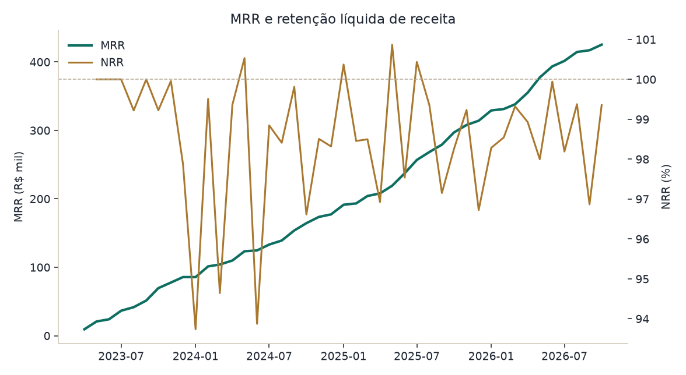

O funil inteiro, do lead criado ao ganho:

| Etapa | Volume | Taxa sobre a anterior |
| --- | ---: | ---: |
| Lead | 6.763 | — |
| MQL | 2.644 | 39,1% |
| SQL | 1.475 | 55,8% |
| Oportunidade | 1.142 | 77,4% |
| Ganho | 477 | 41,8% |

Lead → ganho fica em **7,1%**. Das oportunidades, 611 foram perdidas e 54 ainda estavam abertas na data de corte. O pipeline aberto soma ACV de R$ 676 mil e **ACV ponderado de R$ 263 mil**.

A etapa atual da oportunidade não serve para desenhar o funil: um ganho está em "ganho" e sairia da contagem de proposta. A consulta [`sql/09_opportunity_stages.sql`](sql/09_opportunity_stages.sql) usa o histórico. No total, qualificação (1.142) ≥ proposta (925) ≥ negociação (659) ≥ ganho (477).

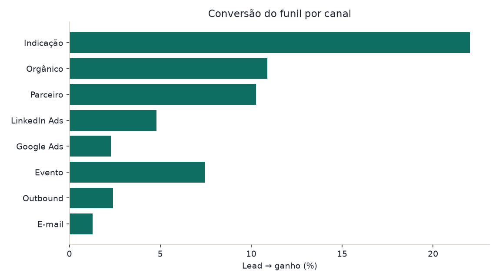

| Canal | Lead → ganho | Clientes | CAC de campanha | Payback |
| --- | ---: | ---: | ---: | ---: |
| Indicação | 22,0% | 163 | sem mídia rastreada | — |
| Orgânico | 10,9% | 113 | sem mídia rastreada | — |
| Parceiro | 10,3% | 52 | R$ 4,9 mil | 4,2 meses |
| Evento | 7,5% | 37 | R$ 7,3 mil | 6,3 meses |
| LinkedIn Ads | 4,8% | 45 | R$ 16,4 mil | 20,9 meses |
| Outbound | 2,4% | 24 | R$ 13,4 mil | 11,9 meses |
| Google Ads | 2,3% | 38 | R$ 28,8 mil | 27,6 meses |
| E-mail | 1,3% | 5 | R$ 11,0 mil | não usar |

CAC aqui é investimento de mídia ou programa dividido pelos clientes daquele canal (first-touch; há um lead por empresa). **Não inclui salário, ferramenta nem overhead.** Orgânico e indicação com CAC vazio não são de graça: só não têm mídia na conta. E-mail tem cinco ganhos; o payback de 9 meses é ruído de amostra pequena.

Google Ads é o pior negócio desta base: muito lead, conversão de 2,3% e payback de mais de dois anos de MRR, 34 meses se descontar a margem de 80% usada como premissa. Parceiro e evento se pagam dentro do ano. Indicação converte o triplo do orgânico e não carrega mídia.

O ciclo mediano, só entre ganhos, fica entre 70 e 78 dias. Google é o mais lento (78).

### Retenção

Churn médio de logos: **1,9% ao mês**. Churn de receita: **1,8%**. Quem sai tem MRR um pouco menor que a média da base, por isso a receita cai menos que a contagem de logos. O denominador é a base do início do mês; o mês de entrada não cancela.

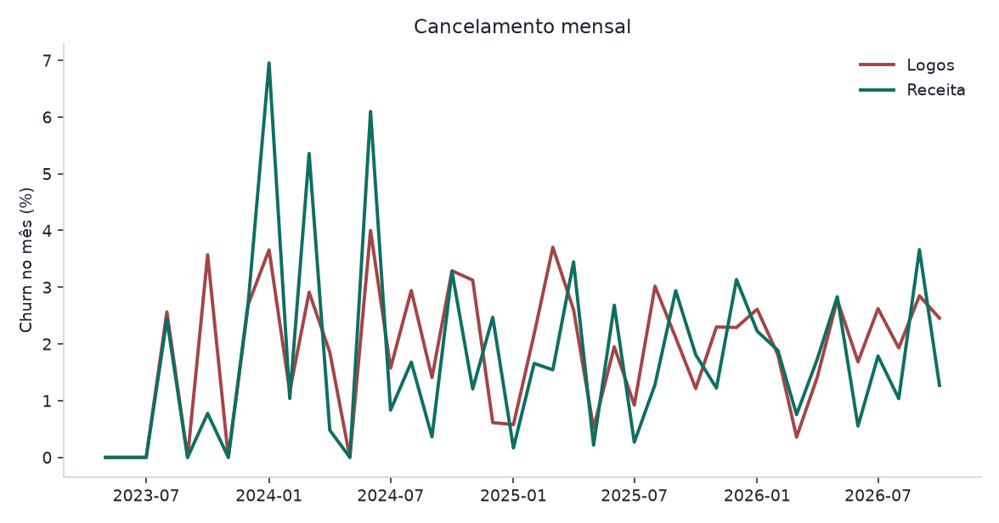

| Idade da coorte | Logos ainda ativos | Receita vs. MRR inicial |
| --- | ---: | ---: |
| 0 | 100% | 100% |
| 6 meses | 88,3% | 88,1% |
| 12 meses | 74,9% | 79,0% |
| 18 meses | 70,3% | 77,4% |

A partir de um ano a receita segura mais do que o logo, porque quem fica expande. Coorte recente ainda não completou 18 meses: a curva longa mistura poucas coortes antigas.

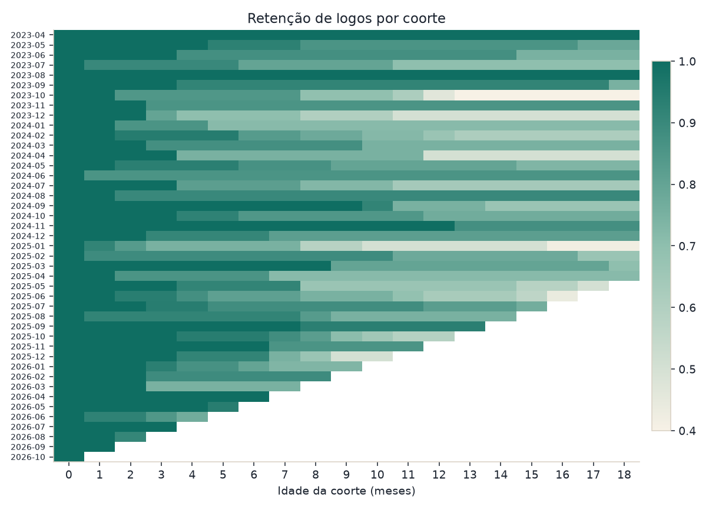

Os motivos de saída dividem o MRR perdido sem um campeão isolado. Concorrente lidera (R$ 35 mil), seguido de baixo uso, produto, encerramento de atividade, preço e suporte. Não dá para cravar uma única causa.

### Segmento e LTV

RFM usa só fatura de assinatura paga (recência até 31/10/2026, frequência e valor em quintis, 5 = melhor). Campeões e leais concentram o histórico. O LTV **esperado** por segmento RFM não deve ser usado: campeão é definido por ainda estar pagando, o churn do recorte vai a zero e a fórmula dispara. Isso está explícito em [`sql/14_ltv_by_segment.sql`](sql/14_ltv_by_segment.sql).

O corte que aguenta a fórmula é o porte, porque porte não é um recorte de sobrevivência.

| Porte | Clientes | MRR médio ativo | Churn mensal | LTV histórico | LTV esperado |
| --- | ---: | ---: | ---: | ---: | ---: |
| MEI | 57 | R$ 184 | 3,7% | R$ 2,6 mil | R$ 3,9 mil |
| Microempresa | 160 | R$ 378 | 1,8% | R$ 6,1 mil | R$ 16 mil |
| Pequena | 168 | R$ 1.122 | 1,9% | R$ 18 mil | R$ 46 mil |
| Média | 92 | R$ 3.443 | 1,4% | R$ 49 mil | R$ 182 mil |

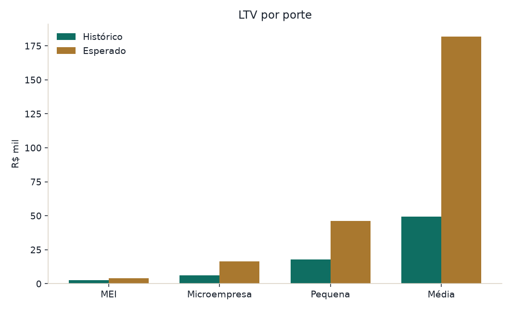

LTV esperado = (ARPU × margem de 80%) / churn mensal. Premissas: churn constante e sem expansão futura. O histórico é o que já foi faturado e está **censurado à direita**. Na média empresa o esperado é quase quatro vezes o histórico porque o churn é baixo e muita gente ainda está ativa. Isso é teto de modelo, não caixa.

## Modelo de propensão a cancelar

Regressão logística, com gradient boosting só como comparação. A foto de treino vai até 30/09/2025. O teste são as fotos de 31/03/2026 e 30/06/2026. O rótulo é cancelar nos 90 dias seguintes, e essa janela termina antes da data de corte, então não há rótulo desconhecido. O corte de probabilidade (0,19) foi escolhido pelo F1 **no treino**.

| | Teste |
| --- | ---: |
| Fotos | 588 |
| Cancelamentos | 40 (6,8%) |
| AUC logística | 0,77 (IC 95% 0,68–0,86) |
| AUC gradient boosting | 0,76 |
| AUC de uma regra (tickets + 2 × faturas atrasadas) | 0,68 |
| Precisão / recall no corte do treino | 50% / 48% |
| Brier do modelo / Brier da taxa do treino | 0,046 / 0,063 |

De 40 cancelamentos, o modelo acerta 19 e solta 19 alertas em quem ficou. A taxa base é 6,8%: precisão de 50% é ganho real de ordenação, e ainda assim metade dos alertas é alarme falso. O boosting não justifica a perda de leitura. Setor ficou de fora do modelo final: doze níveis inchavam a soma dos coeficientes sem melhorar o AUC.

220 empresas do teste já tinham aparecido no treino, em data anterior. Só entre as inéditas, o AUC cai para **0,68**, colado na regra operacional. Parte do 0,77 é cliente reincidente, não um poder que se transfere limpo para uma carteira nova.

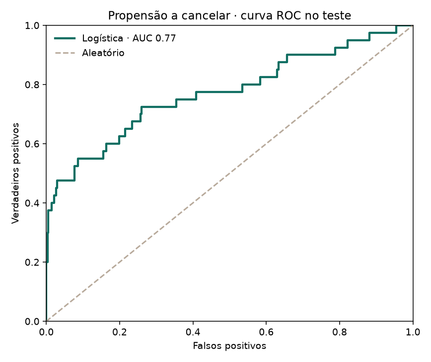

O gerador faz cerca de sete em cada dez cancelamentos deixarem rastro nos dois meses anteriores (mais chamados, CSAT pior, fatura atrasada). Os outros saem em silêncio, e uma minoria de quem fica também abre chamado. **O AUC mede esse mecanismo sintético. Não é performance de um CRM real e não autoriza acionar cliente nenhum.**

## Dashboard

O Streamlit tem cinco páginas: Início, Funil, Receita e MRR, Retenção e coortes, Segmentação. O recorte de canal, porte e ano recalcula a taxa a partir dos volumes. As capturas abaixo são dessa aplicação.

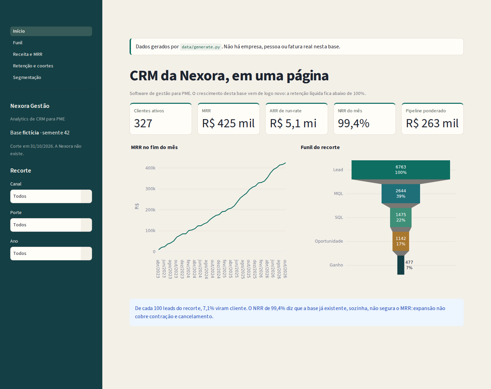

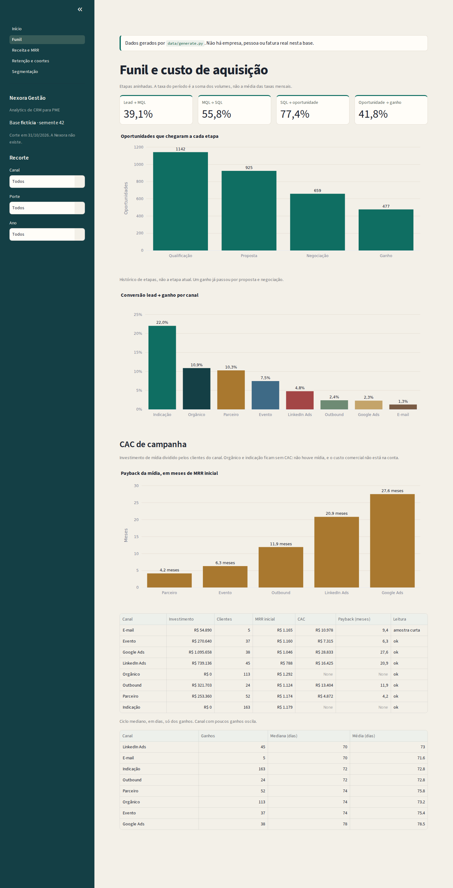

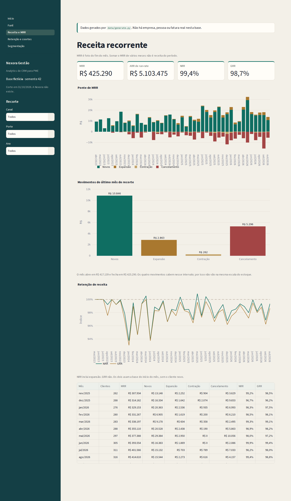

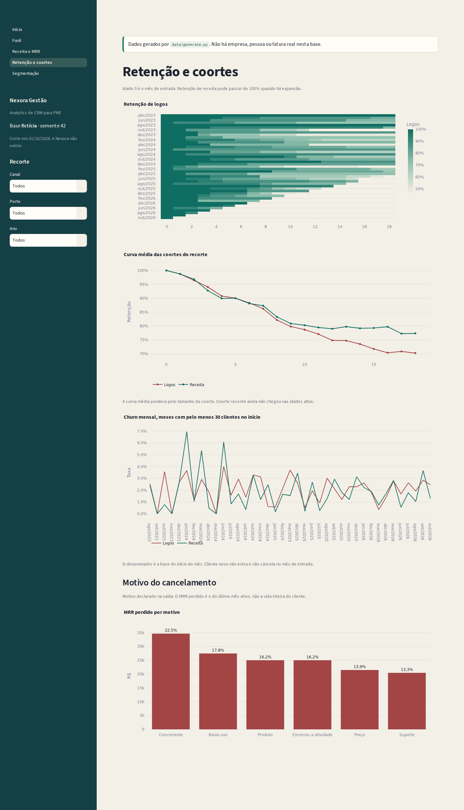

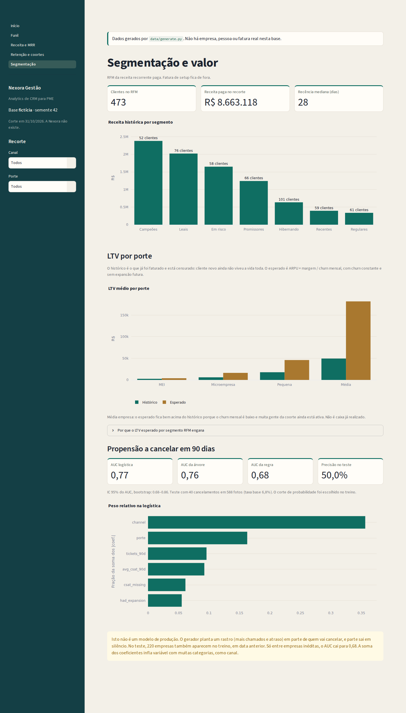

O mesmo desenho em Power BI, sem arquivo `.pbix`, está em [`docs/powerbi.md`](docs/powerbi.md): relacionamentos, medidas DAX e as armadilhas (não somar MRR no tempo, não tirar média de taxa, não tratar CAC vazio como zero).

## Modelo de dados

Camada operacional, consultada pelos arquivos em `sql/` (DuckDB; o DDL cabe em Postgres com chave primária e estrangeira):

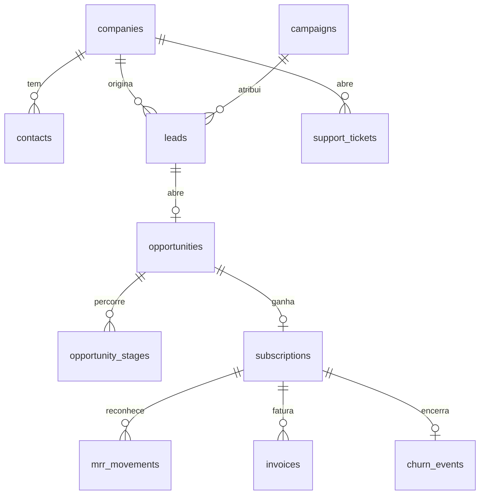

A ponte de MRR obedece, em todo cliente-mês:

`ending = beginning + new + expansion - contraction - churn`

NRR = `(beginning + expansion - contraction - churn) / beginning`. GRR tira a expansão. Cliente novo não entra em nenhuma das duas.

A estrela para Power BI está em `data/warehouse/star/`: `dim_date`, `dim_company`, `dim_channel`, `dim_porte`, `dim_sector`, `dim_plan`, `dim_stage`, `dim_campaign`, `dim_churn_reason`, `dim_loss_reason`, `fact_lead`, `fact_opportunity`, `fact_mrr_month`, `fact_invoice`, `fact_ticket`, `fact_churn`.

## Limitações

- Tudo aqui é simulação. Os parâmetros de conversão, preço e risco estão no gerador e não foram estimados de um cliente.
- Atribuição é first-touch porque existe um único lead por empresa. Não há multi-touch.
- CAC não é fully loaded.
- Não há reativação. Quem cancela sai.
- LTV esperado ignora expansão futura e trata o churn como constante.
- Coorte recente está censurada: histórico menor não significa cliente pior.
- O modelo de churn tem 40 positivos no teste. O intervalo do AUC é largo de propósito.
- Motivo de perda e de cancelamento é sorteado, não é texto livre de um vendedor.

## Mapa do repositório

| Caminho | Função |
| --- | --- |
| `data/generate.py` | Gera a base fictícia |
| `sql/` | DDL e consultas comentadas |
| `analysis/` | Métricas, figuras e modelo |
| `app/` | Dashboard Streamlit |
| `notebooks/analise_crm_pme.ipynb` | Leitura guiada |
| `tests/` | Pytest |
| `docs/` | Dicionário, Power BI, figuras e capturas |
| `.github/workflows/ci.yml` | Ruff e pytest |

Kleidson Almeida Santos.
